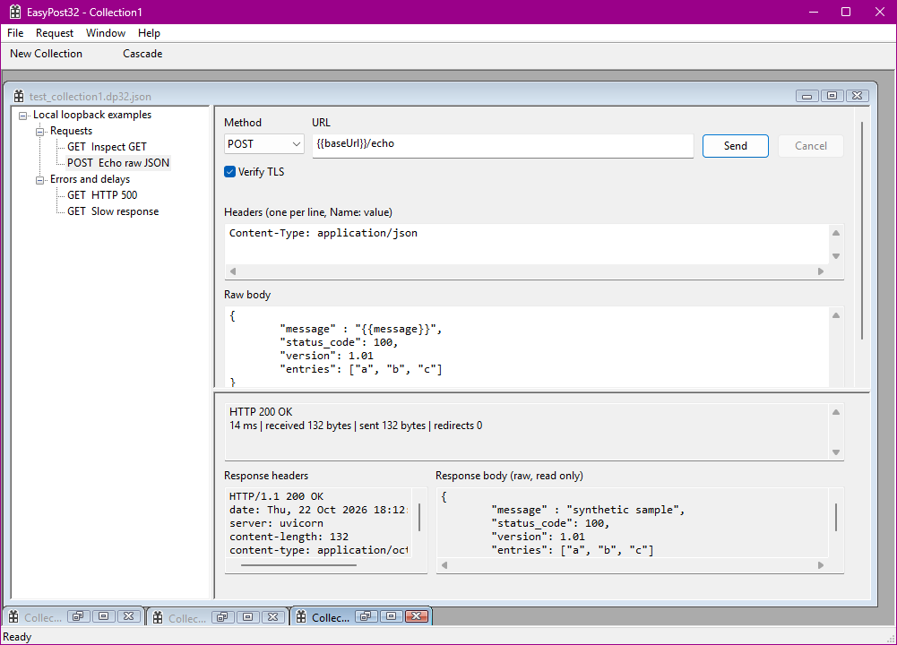

EasyPost32
==========
EasyPost32 is the Postman demake. Create requests in JSON or XML and send them wherever. Backed by the powerful libcurl, it's here to help you develop and test any API.

- MDI interface to manage multiple collections
- No Sign In required. In fact, there isn't anything to sign into. EasyPost32 is 100% local!
- Create and save collections
- Import OpenAPI and Postman collections
- Replay requests
- Sends HTTP verbs GET, POST,  PUT, DELETE, HEAD, OPTIONS
- Native Windows application
- Very lightweight. You'll struggle to locate it in Task Manager.
- The 32 doesn’t mean 32-bit, but fully Win32!

The HTTP Client that's made to be forgotten. 
